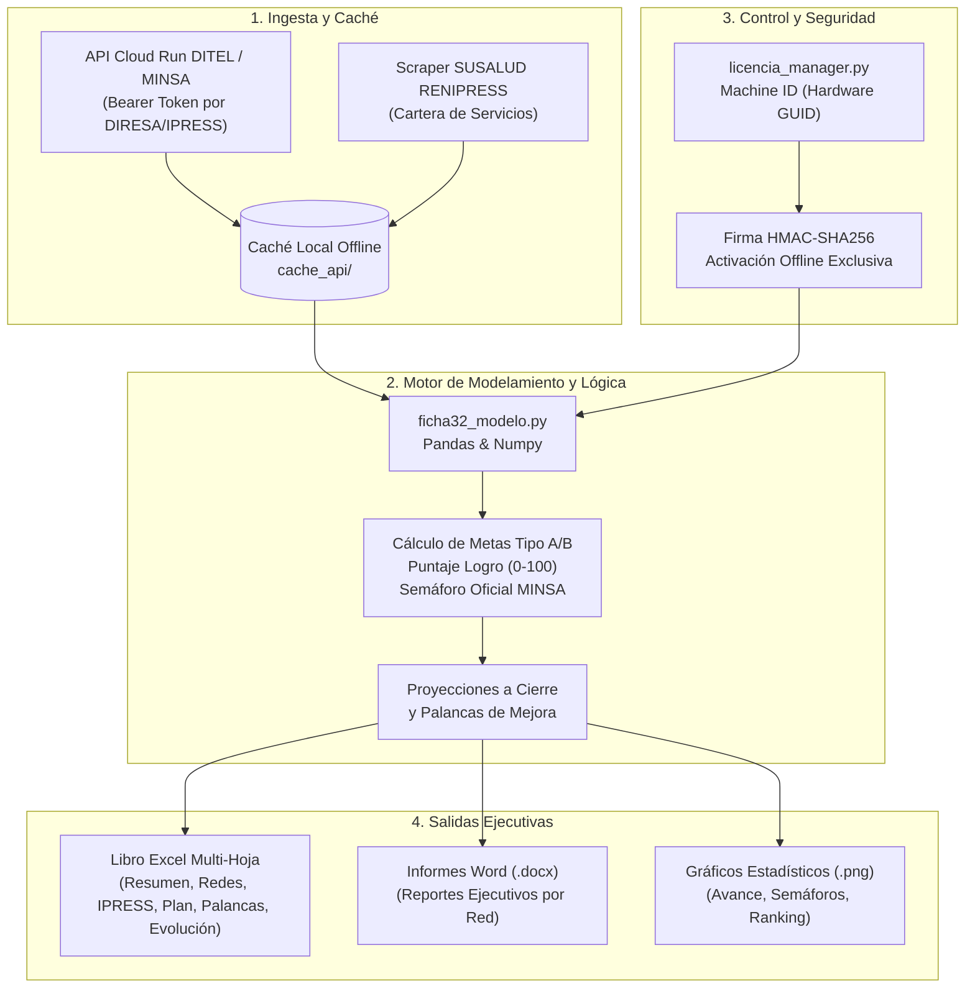
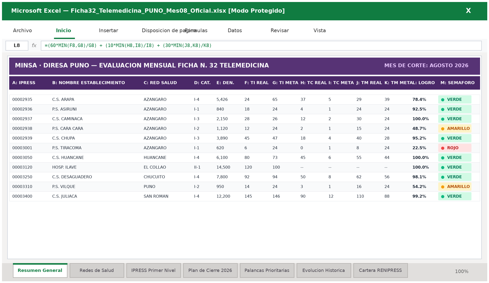
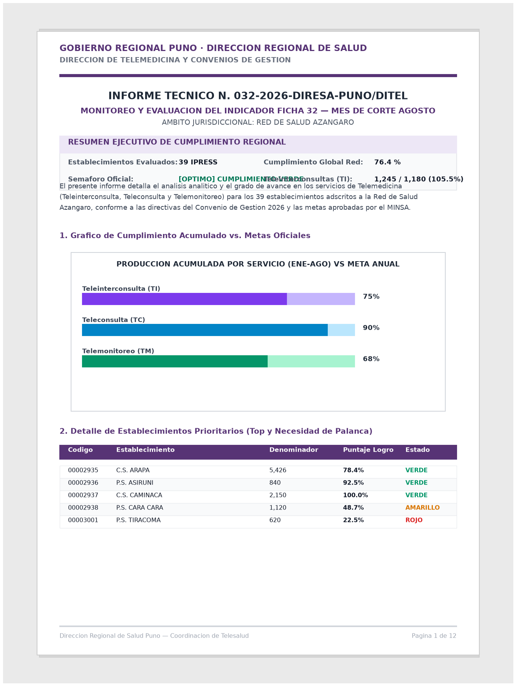
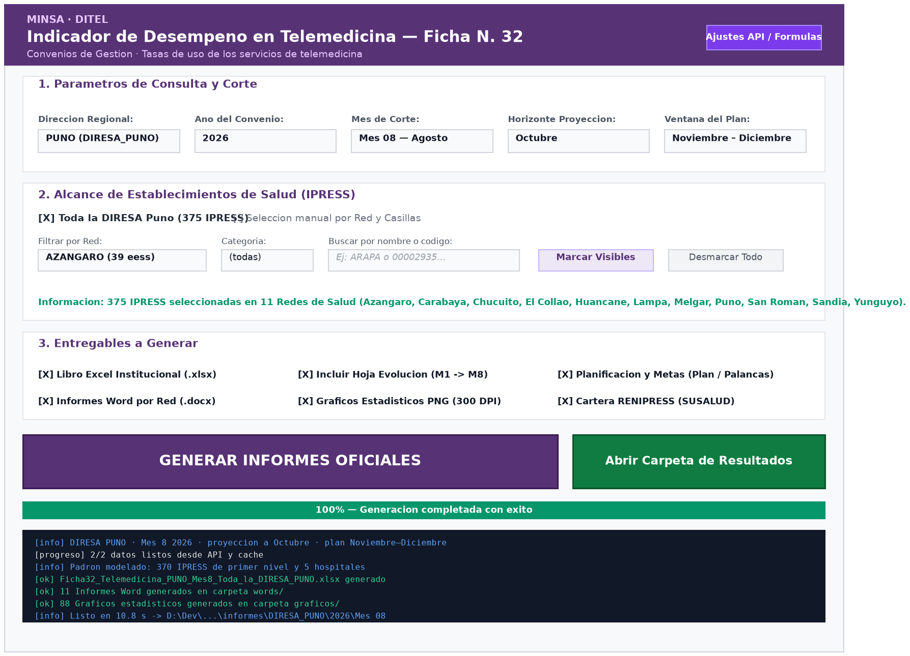
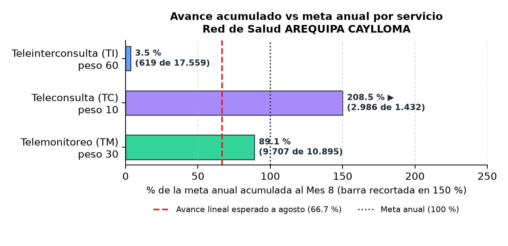
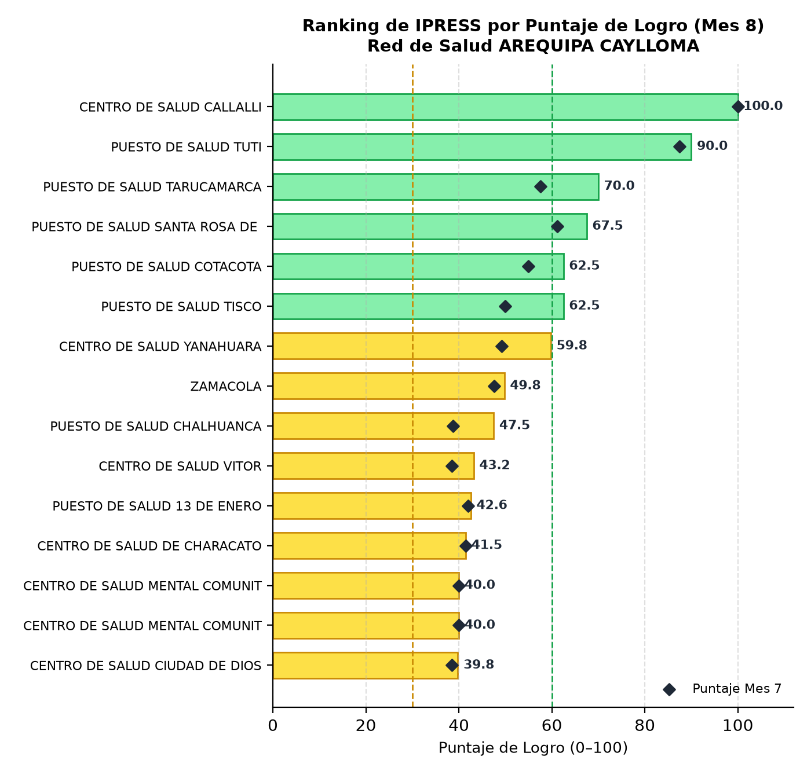
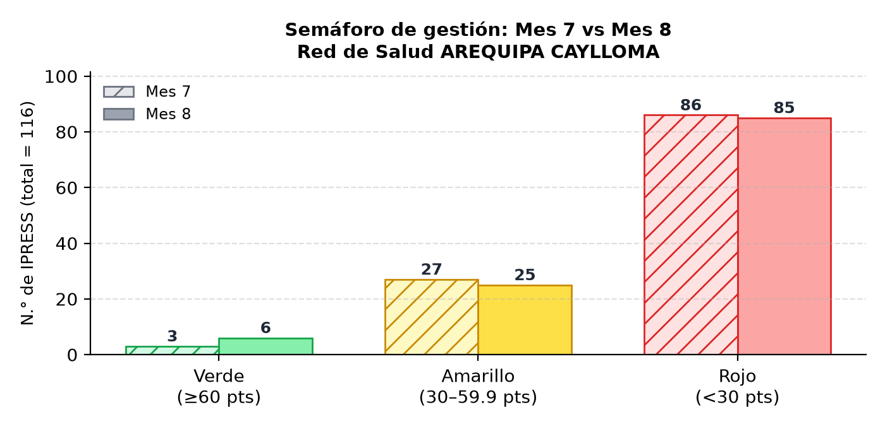

# Ficha N.° 32 · Telemedicina — Automatización Analítica y Generador de Informes (`Ficha32-DIRESA-PERU`)

[](https://www.python.org/)
[](https://www.microsoft.com/)
[](https://www.gob.pe/minsa)
[]()

> **Sistema integral de extracción, modelamiento estadístico y generación automatizada de informes ejecutivos (Excel, Word y Gráficos)** para el monitoreo de los indicadores de telemedicina en los convenios de gestión de las Direcciones Regionales de Salud (DIRESA / GERESA) del Perú.

---

## 📋 Resumen Ejecutivo e Impacto del Proyecto

En el marco de los **Convenios de Gestión del MINSA**, la **Ficha Técnica N.° 32** evalúa el desempeño en telemedicina (Teleinterconsulta, Teleconsulta y Telemonitoreo) en cientos de establecimientos de salud (IPRESS) de primer y segundo nivel. 

Anteriormente, el personal administrativo requería días de trabajo manual para descargar tablas aisladas, calcular fórmulas complejas, generar reportes de seguimiento para cada red de salud y proyectar metas de fin de año.

Este software **automatiza el ciclo de vida completo de la información en segundos**:
1. **Conexión y Sincronización:** Consume la API oficial de la Dirección de Telemedicina (DITEL) y cruza datos con SUSALUD RENIPRESS.
2. **Modelamiento Matemático:** Aplica las fórmulas oficiales del convenio (ponderaciones 60/10/30, pisos mínimos, factores por denominador poblacional, proyecciones lineales y semáforos de cumplimiento).
3. **Generación Automatizada:** Produce en menos de 15 segundos libros contables Excel multi-hoja, informes ejecutivos en Word por cada red de salud y gráficos estadísticos de alta resolución.
4. **Distribución Segura:** Diseñado para usuarios no técnicos mediante una interfaz gráfica de escritorio (GUI) y empaquetado en un ejecutable standalone protegido por **huella de hardware (Machine ID)**.

---

## 🏛️ Arquitectura del Sistema



---

## 📊 Galería Visual de Entregables y Documentos Generados

El sistema produce automáticamente los entregables listos para la firma de gerencia y toma de decisiones:

### 1. Documentos Ejecutivos Automatizados (Excel y Word)

| Libro Contable Excel Multi-Hoja (.xlsx) | Informe Técnico Oficial Word (.docx) |
|:---:|:---:|
|  |  |
| *Libro completo con 7 pestañas: Resumen General, Redes, IPRESS Primer Nivel, Plan 2026, Palancas, Evolución Histórica y Cartera RENIPRESS con semáforos condicionales.* | *Informe institucional formal con estructura oficial DIRESA/MINSA, tablas de IPRESS priorizadas y gráficos estadísticos empotrados.* |

---

### 2. Aplicación de Escritorio y Gráficos Estadísticos

| Interfaz Gráfica de Escritorio (GUI) | Avance Acumulado vs. Meta Anual |
|:---:|:---:|
|  |  |
| *Aplicación administrativa intuitiva con filtros rápidos por Red de Salud, categorías (I-1 al II-2) y barra de progreso asíncrona.* | *Monitoreo en tiempo real del porcentaje de avance en Teleinterconsulta, Teleconsulta y Telemonitoreo frente a las metas.* |

| Ranking de Cumplimiento por Red de Salud | Semáforo de Desempeño Institucional |
|:---:|:---:|
|  |  |
| *Comparativa regional de las redes de salud para asignación focalizada de asistencia técnica y soporte operativo.* | *Distribución de establecimientos según los umbrales oficiales del convenio (Verde ≥ 60%, Amarillo 30–59.9%, Rojo < 30%).* |

---

## 🛠️ Stack Tecnológico

- **Lenguaje:** Python 3.10+
- **Interfaz de Usuario (GUI):** Tkinter / TTK con ejecución en hilos asíncronos (`threading`) para evitar congelamiento de la interfaz.
- **Análisis y Modelado de Datos:** `pandas`, `numpy`.
- **Generación de Reportes:** `xlsxwriter`, `openpyxl`, `python-docx`.
- **Visualización de Datos:** `matplotlib` (Backend Agg headless).
- **Conexión REST & Web Scraping:** `requests`, `urllib`, `beautifulsoup4`.
- **Seguridad & Licenciamiento:** `hmac`, `hashlib`, Windows Registry (`winreg`).
- **Empaquetado y Distribución:** `pyinstaller` (Configuración en `Ficha32_Telemedicina.spec`).

---

## 🔒 Control de Distribución y Licenciamiento por Hardware (Machine ID)

Para evitar la redistribución no autorizada en computadoras ajenas a la institución, el ejecutable `.exe` cuenta con un sistema de **licenciamiento criptográfico offline**:

1. **Lectura de Huella Única:** Cada equipo genera un `Machine ID` único (basado en el `MachineGuid` de Windows y características del procesador/equipo, e.g. `DIR-E48C-BDD8-B22B`).
2. **Generador Privado de Activación:** El administrador del sistema utiliza la herramienta interna privada `generar_codigo.py` para emitir la clave criptográfica correspondiente (`ACT-XXXX-XXXX-XXXX`) mediante HMAC-SHA256.
3. **Persistencia Segura:** Una vez activado, la licencia queda registrada en `%LOCALAPPDATA%`, permitiendo operar al usuario sin requerir conexión a internet en ningún momento.
4. **Modo Desarrollo:** En el código fuente, la verificación se omite automáticamente a menos que se invoque con `--probar-licencia`.

---

## 📂 Estructura del Proyecto

```text
Proy. Ficha32/
├── app_ficha32.py              # Interfaz gráfica principal de escritorio (Tkinter)
├── config_manager.py           # Gestor centralizado de configuración dinámica
├── config.json                 # Parámetros editables (URLs, ponderaciones, metas)
├── docx_utils.py               # Utilidades de maquetación y estilos Word
├── extraer_hospitales.py       # Extractor y clasificador de IPRESS tipo hospital
├── ficha32_api.py              # Cliente API REST DITEL y scraper SUSALUD
├── ficha32_evolucion.py        # Algoritmo de series temporales y hoja Evolución
├── ficha32_graficos.py         # Generador de gráficos analíticos con Matplotlib
├── ficha32_modelo.py           # Núcleo de cálculo, metas y proyección
├── generar_excel.py            # Generador del libro Excel institucional
├── generar_reportes_redes.py   # Generador de informes Word por red de salud
├── generar_todo.py             # Orquestador del pipeline (usado por CLI y GUI)
├── licencia_manager.py         # Módulo de verificación de licencia por Machine ID
├── nombres_hospitales.py       # Diccionario institucional de nombres oficiales
├── Iniciar_Ficha32.bat         # Acceso directo para usuarios en Windows
├── compilar_ejecutable.bat     # Script de compilación PyInstaller a .exe
├── Ficha32_Telemedicina.spec   # Especificación de bundling PyInstaller
├── requirements.txt            # Dependencias del entorno de Python
├── xls_base/                   # Plantillas y datos base para modo 100% offline
└── docs/                       # Documentación visual y capturas para portafolio
    └── img/                    # Gráficos y capturas de muestra
```

---

## 🚀 Instalación y Puesta en Marcha

### Opción A: Ejecución desde Código Fuente (Desarrolladores)

1. Clonar el repositorio:
   ```bash
   git clone https://github.com/JosephElvisMaman1/Ficha32-DIRESA-PERU.git
   cd Ficha32-DIRESA-PERU
   ```

2. Crear y activar un entorno virtual:
   ```bash
   python -m venv venv
   venv\Scripts\activate
   ```

3. Instalar dependencias:
   ```bash
   pip install -r requirements.txt
   ```

4. Iniciar la aplicación:
   ```bash
   python app_ficha32.py
   ```

### Opción B: Uso por Línea de Comandos (CLI / Automatización en Lote)

```bash
# Generar Excel completo con evolución para toda la DIRESA Puno (Mes 8)
python generar_todo.py --diresa PUNO --mes 8 --anio 2026 --excel --evolucion

# Generar informes Word y gráficos específicos para una Red de Salud
python generar_todo.py --diresa PUNO --mes 8 --word --graficos --alcance red:AZANGARO

# Generar reporte enfocado únicamente en establecimientos seleccionados
python generar_todo.py --diresa PUNO --mes 8 --excel --alcance ipress:00002936,00003251
```

---

## 📈 Reglas de Negocio del Convenio de Gestión

El indicador pondera 3 componentes fundamentales de la telemedicina:

| Servicio | Código | Ponderación | Meta Anual Tipo A (EESS I-1 al I-4) | Meta Tipo B (Hospitales) |
|---|:---:|:---:|---|---|
| **Teleinterconsulta** | `TI` | **60 %** | `máx(24, 0.012 × Denominador)` | `máx(100, 0.004 × Denominador)` |
| **Teleconsulta** | `TC` | **10 %** | `máx(1, 0.001 × Denominador)` | *No aplica* |
| **Telemonitoreo** | `TM` | **30 %** | `máx(24, 0.0072 × Denominador)` | *No aplica* |

- **Semáforo Oficial:**
  - 🟢 **Verde (Óptimo):** Cumplimiento $\ge 60\%$
  - 🟡 **Amarillo (En proceso):** Cumplimiento entre $30\%$ y $59.9\%$
  - 🔴 **Rojo (Crítico):** Cumplimiento $< 30\%$

---

## 👨‍💻 Autor y Contacto

Desarrollado para la optimización del seguimiento de la gestión sanitaria en telemedicina.
- **Institución:** Prácticas Pre-Profesionales / DIRESA - MINSA
- **Propósito:** Automatización de Procesos de Salud Pública e Inteligencia de Datos
- **Contacto:** https://www.linkedin.com/in/joseph-elvis-mamani-mendoza-9a16bb337/
